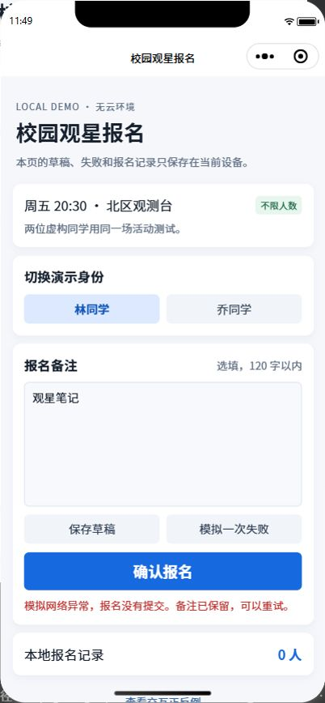
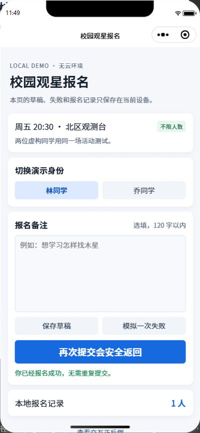
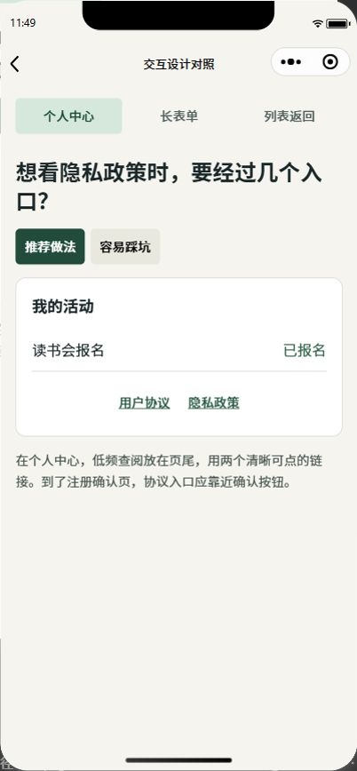
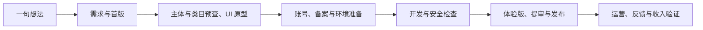

# 零基础做微信小程序：从一句想法到上线、运营和收入验证

**只会说「我想做个小程序」，就可以开始。** 安装后用一句话启动，想法还模糊，AI 会接着问。它陪你画出第一版、在手机上跑起来、准备备案和提审。等第一批人用起来，再陪你看懂哪一步流失、谁愿意付钱、每一单到底能留下多少钱。

```text
我想做一个校园二手信息小程序。我不懂开发，也不知道能不能直接做交易。
请先问我关键问题，告诉我主体、类目、备案和审核上可能卡在哪里。
先给我一个低成本可上线的首版方案，再一步一步带我做完。
```

它不会上来就丢给你一堆代码。它会先追问目标用户、首版边界、谁负责内容和运营，再把每一步翻译成你能听懂的话。你确认后，它再推进下一步。

[**从一句话开始用**](#从这里开始) · [**打开可操作的验收演示**](https://suhao1314.github.io/wechat-miniprogram-skills/) · [**拿两张截图找页面问题**](https://suhao1314.github.io/wechat-miniprogram-skills/compare.html) · [下载 ZIP](https://github.com/suhao1314/wechat-miniprogram-skills/archive/refs/heads/main.zip)

### 店员还需要电脑后台、官网或 H5？

这不是让小程序硬塞一个“后台页”。当你说“商家想在电脑上看订单”“还想做官网”“要一个给客户看的链接”时，Skill 会主动把已确认的角色、数据状态和接口约定交给配套的 [网页、官网和管理后台 Skill](https://github.com/suhao1314/web-product-delivery)，再用同一条测试记录核对网页和小程序是否读到同一笔数据。只有需要云端存储或偶尔在手机里看名单时，它不会擅自建议新建网站。

## 先把一个小程序跑在微信里

**不用先买云服务。下载仓库，把报名样板文件夹导入微信开发者工具，就能看见代码怎样处理一次失败。** 打开时选自己的测试号或有权限的 AppID。界面和测试共用同一份报名逻辑。

| 你可以当场试 | 仓库里可以带走什么 |
| --- | --- |
| 备注写到一半退出，重新打开；故意让第一次提交失败，再连续点两次报名 | 可导入的 WXML/WXSS 工程、自动恢复草稿、按身份隔离、一键运行的本地回归和可重复的微信模拟器验收。[导入原生报名样板](skills/launch-wechat-miniprogram/assets/signup-demo/README.md) |
| 在同一个微信页面切换推荐做法与反例，看哪一种让人少点一步、少重填一个字段 | 协议入口、长表单报错、列表返回三组可操作案例。[打开实验说明](skills/launch-wechat-miniprogram/references/native-field-guide.md) |
| 同一套问答换一个客户，学生、导师、审核员的权限怎样跟着换？ | 一份业务模块、两种宿主、两份隔离数据。用本地命令验证谁能看到待审内容、谁能回答。[复用问答模块](skills/launch-wechat-miniprogram/assets/qa-module/README.md) |

<table><tr><td></td><td></td><td></td></tr><tr><td>第一次提交失败 · 0 人</td><td>重试并重复提交 · 1 人</td><td>原生 UI 正反例</td></tr></table>

这些截图来自微信开发者工具。报名样板使用虚构身份及设备本地存储，跨手机抢名额需要共享后端另测。维护者还可以查看[本次新旧版对照评测](skills/launch-wechat-miniprogram/references/skill-comparison.md)。

## 从开工到上线后，你能拿到什么

| 你可能卡住的地方 | Skill 会和你一起产出什么 |
| --- | --- |
| 想法很模糊，只会说“想做个小程序” | 把人群、核心任务、首版范围、暂时不做的功能写成项目计划。它会提问，你拍板。 |
| 不知道页面怎么才像成熟产品 | 为同一个任务给出三种小程序布局，解释哪种更省点击、怎么安排复制、草稿、搜索、报错和空状态。确认方向后再开发。 |
| 不懂 AppID、主体、备案、类目和审核 | 按你的业务、主体和当前规则梳理要做的官方步骤。交易、社区、医疗、教育等高要求方向会主动提示资质风险，并先找能保住核心价值的首版替代方案。 |
| 不知道需不需要后台，担心花钱 | 用“换手机后还要不要看见”“是否多人共享”“是否需要上传和管理员”等问题判断。能本地做就不强行上云，需要云开发时才讨论环境、权限、日志、备份和费用提醒。 |
| 写出来能跑，担心用户一用就出问题 | 按真实用户动作验收。弱网、拒绝授权、重复点报名、草稿恢复、跨账号访问、空页面和分享打开都要覆盖。 |
| 要提审了，却不知道审核员会怎么点 | 整理体验版、审核路径、测试账号、隐私说明、用户内容、退出账号、分享入口和常见拒绝点。平台的实名、扫码、资质提交和正式发布由你在官方页面操作。 |
| 上线后不知道看什么，怎么不被成本和故障拖住 | 记录版本、日志、费用、备份、用户反馈和下一版。把安全验收、故障响应和恢复演练列进交接，让负责人知道谁能处理、先做什么。 |
| 有人用过以后，想验证是否值得继续投钱 | 定义一版只验证一个关键结果，例如报名完成率、有效信息量、复访、管理员处理时长或付费转化。先看数据和用户反馈，再决定加功能、做推广或尝试收费。 |

例如，学生用活动报名工具免费报名，主办方会愿意为整理签到名单付费吗？先约一个人试一场，记下省了多少工时。有人愿意付钱，再算单场收入扣掉服务、云资源和退款后还剩多少。涉及商用时，先核对项目与所用技能的授权。[一周运营行动与成本算例](skills/launch-wechat-miniprogram/references/operations-and-revenue.md) · [本仓库许可](LICENSING.md)

## 一条从零到一的路线



每一站都有可交接的结果，包括项目计划、重要决策、测试报告、发布检查单和版本变更记录。没有确认过的内容会标成待确认。没有跑过真机、体验版或线上环境的内容也会如实标成未验证。

## 几个常见的现实难题，它怎么处理

**“我想做校园二手交易，但暂时拿不到交易相关资质。”**

它不会把信息展示、私下联系和平台担保交易混成一件事。先查当前类目和主体条件。条件不够时，可以先规划成发布信息、筛选和联系的工具，关闭支付、担保和平台撮合等高风险能力，按缩减后的实际功能重新核对信息发布、内容审核和联系入口的类目与资质；确认可做后，再验证是否有人愿意发布。

**“我想做论坛，担心有人发违规内容。”**

它会在开工时讨论昵称重名、用户号、举报、审核角色、下架、申诉和留痕。用户内容的资质和平台规则仍要按当前官方要求核实，内容安全也需要项目方安排真实负责人。

**“我想收报名费，点了支付成功算不算到账。”**

它会把金额、库存、订单归属、重复请求、回调验签、退款和异常放在服务端处理。前端页面显示“成功”并不能作为到账依据。支付、退款和真实通知默认不碰，直到你对具体测试或生产目标给出单项授权。

## 亲手试一次：最后一个名额，两个人同时报名

[](https://suhao1314.github.io/wechat-miniprogram-skills/)

打开 [夜航互动演示](https://suhao1314.github.io/wechat-miniprogram-skills/) 后，你可以亲手试三件事。

- 写一条报名备注，保存草稿，刷新后切换到另一个账号，检查草稿有没有串给别人
- 模拟断网提交，再重试，检查名额会不会在失败时被错误占用
- 让两个账号争最后一个名额，检查谁成功、另一个人得到的反馈、操作记录是否说得清楚

演示使用虚构数据和浏览器本地状态。微信真机、云端并发、支付和正式审核需在你的项目环境分别验证。仓库还带有 [像素差异原图](docs/evidence/difference.png)，以及一个可把你自己的两张同尺寸 PNG 放进浏览器对比的页面。

## 从这里开始

### 安装到支持 Agent Skills 的工具

把下面文字发给你的 AI 编程工具。

```text
请从 https://github.com/suhao1314/wechat-miniprogram-skills 安装 skills/launch-wechat-miniprogram。
我也需要可选的模拟器截图验收，请安装同级 skills/wechat-page-qa。
装好后告诉我应该怎样在新对话中调用，并从我的想法开始提问。
```

安装后，直接用日常的话描述你现在卡住的事，例如“我想做一个校园报名小程序”“商家还需要电脑后台”“这张页面图哪里不方便”“体验版怎么给客户演示”。它会按上下文进入需求、界面、开发、验收或配套网站的步骤，不要求背固定提示词。只有已安装的工具没有自动选中技能时，再输入 `$launch-wechat-miniprogram` 作为兜底。不同工具的安装目录和调用方式会不同，以工具当前说明为准。Skill 文件能被读取，不表示 AI 已经连接了你的微信账号、开发者工具或云环境。

### 手动安装

1. 打开 [仓库页面](https://github.com/suhao1314/wechat-miniprogram-skills)，选择 **Code → Download ZIP**。
2. 解压后，将 `skills/launch-wechat-miniprogram` 整个文件夹复制到你的 AI 工具支持的 Skills 目录。
3. 需要自动拍摄模拟器页面时，再复制同级 `skills/wechat-page-qa` 文件夹。
4. 新对话直接描述你的目标或当前页面问题。工具没有自动识别时，再调用 `$launch-wechat-miniprogram`；不支持这个写法时，让它读取 `launch-wechat-miniprogram/SKILL.md`。

已有同名 Skill 时先比较版本和文件，不要直接覆盖。

## 它会替你安排，还是需要你亲自做

| Skill 和 AI 可协助 | 需要项目负责人亲自完成 |
| --- | --- |
| 拆需求、做 UI 方案、写代码、整理项目文档、跑可授权的检查、给出资质路径和替代方案 | 注册账号、实名、登录、扫码、提交资质、支付开通、体验版成员授权、最终提审、正式发布和真实资金操作 |
| 生成测试用例、排查代码、比较截图、列出安全待验项、整理运营指标 | 确认主体是否合格、提供真实业务规则、承担内容审核、决定收费方式、处理用户投诉和线下履约 |

这条边界很重要。它能把复杂流程拆清楚，让你少走弯路，不能替任何人获得资质、通过平台审核或保证项目盈利。

## 开发者如何验证和贡献

主 Skill 自带结构检查、项目静态检查和单元测试。修改后在 `skills/launch-wechat-miniprogram` 目录运行：

```bash
python scripts/validate_skill.py .
python scripts/validate_skill.py . --check-links
python -m unittest discover -s tests -v
```

截图像素对比工具在 [visual-regression](skills/launch-wechat-miniprogram/tools/visual-regression) 目录，安装锁定依赖后运行 `npm test`。这些检查不代替开发者工具编译、安卓/iPhone 真机、体验版和正式环境验证。

欢迎 Fork 后提交改进。提交前请说明改了什么、如何检查、仍有哪些边界。不要在 Issue、代码或截图中提交 AppSecret、支付密钥、验证码、真实用户资料或其他敏感信息。

## 致谢与许可

本项目基于 niuhuoshan 的 [launch-wechat-miniprogram](https://github.com/niuhuoshan/launch-wechat-miniprogram) 扩展。页面设计方向参考花叔的 [Huashu Design](https://github.com/alchaincyf/huashu-design)，已按微信小程序场景重新编写。

本版新增的原创内容采用 **PolyForm Noncommercial 1.0.0**，可按条款学习、复刻和分享。把受该许可约束的内容用于商业外包、付费代搭或收费服务，需要先取得单独商用授权。历史 MIT 版本、上游内容和第三方依赖继续按各自许可使用。[许可范围与商用联系](LICENSING.md) · [许可证全文](LICENSE)
