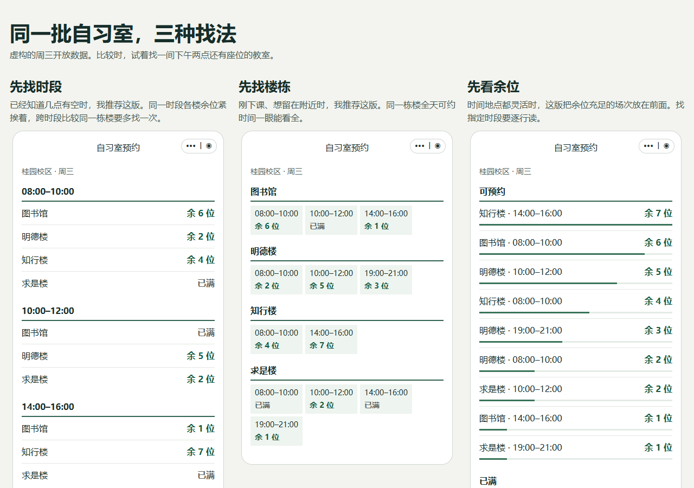

# 微信小程序开发与页面验收 Skills

把「我想做个小程序」变成可以在手机上试的项目。AI 会追问影响首版的需求，拿同一页的三种排法给你看，解释哪种操作更省事，再带你走开发、体验版和提审准备。

## 同一批自习室，三种找法



知道几点有空，先看时段。刚下课想就近找座，先看楼栋。时间地点都灵活，先看余位。三版用同一批虚构记录，可以直接对照设计取舍。[离线样张 HTML](skills/launch-wechat-miniprogram/assets/mobile-directions.html) 可随仓库下载，在本地浏览器中打开。

## 从这里开始

最省事的方式是把下面提示词复制到支持 Agent Skills 的 AI 编程工具的新对话里。主技能作为入口，可选页面验收技能与它同级安装：

```text
请从 https://github.com/suhao1314/wechat-miniprogram-skills 安装 skills/launch-wechat-miniprogram。
我也需要可选的模拟器截图工具，请将 skills/wechat-page-qa 安装到同一个技能目录。
如已有同名技能，请先核对版本。装好后告诉我如何在新对话里调用。
```

安装后，在新的对话中输入 `$launch-wechat-miniprogram` 启动主技能。不同工具的安装目录和调用方式可能不同，以该工具当前说明为准；技能文件可读不代表 AI 已连接你的本机、微信账号或开发者工具。

## 手动安装

如果你的 AI 工具没有安装器，可以从 GitHub 下载仓库 ZIP：

1. 打开 [仓库页面](https://github.com/suhao1314/wechat-miniprogram-skills)，选择 **Code → Download ZIP**。
2. 解压 ZIP，在 `skills` 目录中找到 `launch-wechat-miniprogram` 文件夹；需要实际页面验收时，再找到同级的 `wechat-page-qa`。
3. 将需要的完整技能文件夹复制到 AI 工具支持的 Skills 目录。目录结构应类似：

   ```text
   <Skills目录>/
   ├── launch-wechat-miniprogram/
   │   └── SKILL.md
   └── wechat-page-qa/       # 可选
       └── SKILL.md
   ```

4. 在新对话中调用 `$launch-wechat-miniprogram`。如果工具不支持 `$技能名`，请告诉它读取安装目录里的 `launch-wechat-miniprogram/SKILL.md`。

已有同名目录时先比较，不要直接覆盖。手动 ZIP 安装需要自己留意后续更新。

## 用法示例

**准备一个新项目：**

```text
$launch-wechat-miniprogram 我想做一个给同学记录拼餐费用的小程序。我是第一次做小程序，请先问清楚关键需求和首版范围，再一步一步带我做；没有确认前不要创建源码，也请把需要我亲自操作的平台步骤说清楚。
```

**评审已有页面：**

```text
$launch-wechat-miniprogram 请评审我发的这张小程序页面截图。直接告诉我最影响使用的问题、你建议怎么改以及理由；结合手机阅读和点击场景判断，不要只给笼统的审美评价。
```

如果是改已有项目，附上目标页面截图、主要用户和当前困扰会更容易得到具体建议。主技能会要求 AI 先了解现有项目，再决定改动范围。

## 测试与可选依赖

主技能仓库包含结构校验脚本和单元测试。修改技能文件后，可在技能目录运行：

```bash
python scripts/validate_skill.py .
python scripts/validate_skill.py . --check-links
python -m unittest discover -s tests -v
```

这些检查用于核对技能文件结构、链接和部分静态行为，不代表生成的小程序已通过开发者工具、真机或线上验收。开发项目时，技能会根据任务选择适用的检查；如需真实页面检查，可选用 `wechat-page-qa`，但需具备相应的微信开发者工具环境，并按技能说明取得授权。

主技能的部分可选工具需要 Node.js/npm 或 Python，具体以相应脚本说明为准。不使用相关能力时，不必安装全部依赖。需要比较两张已拍好的截图时，进入 [像素对比工具](skills/launch-wechat-miniprogram/tools/visual-regression)，运行 `npm ci --ignore-scripts` 和 `npm test`。自动拍摄模拟器页面另需同级的 [wechat-page-qa](skills/wechat-page-qa/SKILL.md)、兼容的 Windows 开发者工具 CLI，以及用户授权。云开发、实名、体验版与提审由使用者在自己的环境操作。

## 参与贡献

欢迎提交建议、问题和改进：

1. Fork 本仓库，在自己的 Fork 中创建分支并提交修改。
2. 提交前运行与改动相关的校验，并在 Pull Request 中说明改了什么、如何检查、还有哪些限制。
3. 遇到缺陷或有改进建议，可先查看现有 [Issues](https://github.com/suhao1314/wechat-miniprogram-skills/issues)，再新建 Issue 描述复现步骤或使用场景。

请勿在 Issue 或提交内容中放入 AppSecret、密钥、真实用户信息或其他敏感资料。提交内容应由贡献者拥有，或明确取得使用授权。

## 致谢与许可

本项目基于 niuhuoshan 的 [launch-wechat-miniprogram](https://github.com/niuhuoshan/launch-wechat-miniprogram) 扩展。本版加入任务驱动的 UI 评审、业务回归场景和模拟器截图对比。页面构思借鉴花叔的 [Huashu Design](https://github.com/alchaincyf/huashu-design)，用微信小程序场景重新编写，使用时无需另外安装。设计方向示例用于启发讨论，不应被误认为微信官方规范或固定模板。

本仓库按 [MIT License](LICENSE) 发布。引用的第三方组件、文档和素材仍适用其各自的许可证或授权要求。
